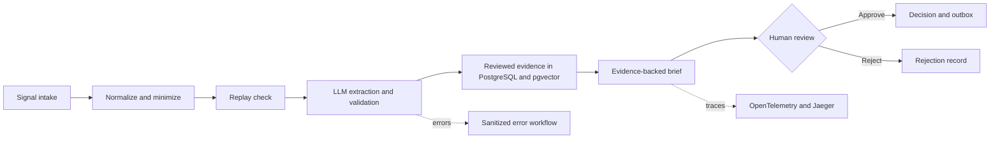

# Product Signal Control Tower

## Overview

A human-in-the-loop workflow for turning product feedback into structured, evidence-backed signals. n8n coordinates extraction, retrieval, brief generation, and the human decision that gates downstream routing.

## Architecture



n8n runs the workflow and review wait. PostgreSQL stores synthetic source events, taxonomy, decisions, and artifacts; pgvector schema supports future retrieval evaluation. OpenTelemetry exports workflow and node traces for inspection in Jaeger. Playwright drives the browser review path and checks the resulting workflow and database state.

## What's tested

- Ordered PostgreSQL migrations, checksum ledger, pgvector objects, application-role access, and refusal to reapply migrations.
- Workflow import defaults to inactive; activation is explicit. The local demo preflight checks its configured dependencies.
- Invalid input, replay, rejection, and approval browser scenarios run with synthetic data and a local structured model mock.
- The static project validator checks workflow structure, fixtures, import settings, and evaluation artifacts. Focused checks cover input minimization, fixture validity, workflow layout, migration batching, import options, and API transport rules.

The 21 gates are an evaluation plan; four Playwright scenarios pass against a local mock. Current run details are in [evaluation/current-mock-run.json](evaluation/current-mock-run.json); dated, redacted historical captures are in [evaluation/historical/](evaluation/historical/).

## Quickstart

Requirements: Node.js/npm, Docker Compose, a local n8n owner account, a Playwright-compatible browser, and n8n credentials for PostgreSQL and a model provider.

```powershell
npm ci --ignore-scripts --no-audit --fund=false
npx playwright install chromium
node tools/init-local-env.mjs
./runtime/scripts/init-env.ps1
./runtime/scripts/start.ps1
node tools/apply-migrations.mjs --dry-run
node tools/apply-migrations.mjs
```

The quickstart uses the model provider configured in n8n. The recorded four-scenario mock run used a separate isolated test instance with its model endpoints directed to a local structured mock. The optional Node initializer creates a root `.env` only when one does not already exist. Create the local n8n owner, then copy `runtime/.n8n-api.env.example` and `runtime/.owner.env.example` to their matching local files and fill in local values. In n8n, configure a PostgreSQL credential for the demo database and a model-provider credential. Import the workflows inactive, review the local settings, then explicitly activate if needed:

```powershell
node tools/import-local-workflows.mjs
node tools/import-local-workflows.mjs --activate
./runtime/scripts/start-observability.ps1
npm run demo:check
node tools/run-playwright-demo.mjs --mode headless --scenarios invalid,replay,reject,approve
```

## Security

Run the example on an isolated local stack and store secrets only in ignored environment files and n8n credentials. The human-review wait link is unauthenticated bearer access, so anyone who obtains it can act on a review; keep the workflow local and private.

## Project layout

- `workflows/` — importable n8n workflows and their code-node sources.
- `database/` — PostgreSQL migrations, pgvector schema, and synthetic seed taxonomy.
- `runtime/` — local Compose configuration and startup, migration, and health-check scripts.
- `fixtures/` — synthetic signals, expectations, reviewed seeds, and browser scenarios.
- `tools/` — workflow generation, import, migration, static validation, and Playwright tools.
- `evaluation/` — the evaluation plan, current mock-run record, and redacted historical results.
- `presentation/interactive/` — self-contained synthetic walkthrough for local browser viewing.

See the [local demo runbook](docs/demo-runbook.md) for setup, manual steps, tracing, and evaluation evidence details.
